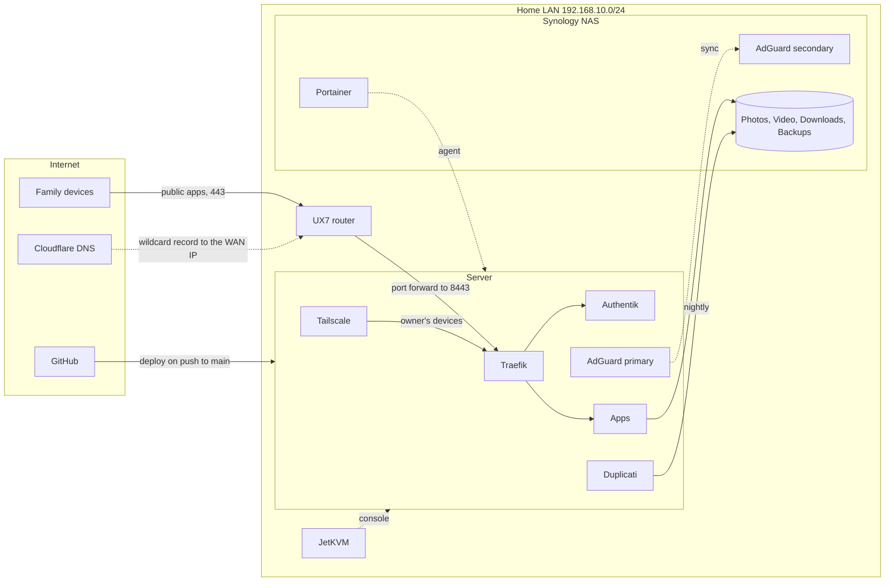
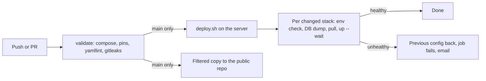

# <domain> homelab

Docker services for the home server (`<hostname>`, `SERVER_HOSTNAME` in `dr.env`). Media, photos and backups live on the Synology NAS.



Every app is reachable on the LAN and over Tailscale. Only the ones with a public router in their `compose.yaml` answer from the internet ([docs/operations.md](docs/operations.md)).

## Where things are
| Path | What |
|---|---|
| `services/<name>/` | One folder per service: `compose.yaml`, `.env.sample`, `README.md` |
| `nas/<name>/` | Stacks that run on the NAS, deployed through Portainer |
| `docs/access.md` | Every web address: where it runs, who reaches it, how they log in |
| `docs/network.md` | VLANs, fixed addresses, server ports, NAS shares |
| `docs/operations.md` | How the internet reaches Traefik; making an app public or internal; deploys and the runner; updates; the public repo |
| `scripts/bootstrap-host.sh` | Prepares a fresh Ubuntu host (packages, folders, NAS mounts, Docker address pool) |
| `scripts/check-env.sh` | Checks every `.env` has the keys its `.env.sample` lists |
| `scripts/deploy.sh` | Deploys the stacks changed since the last good deploy, rolls back if unhealthy. The `deploy` workflow runs it after `validate` ([docs/operations.md](docs/operations.md#deploys)) |
| `.publicignore` | Files left out of the public copy of this repo. `scripts/publish-public.sh` builds the copy, `scripts/import-pr.sh` brings public PRs in ([docs/operations.md](docs/operations.md#public-repo)) |
| `renovate.json5` | Renovate: which image updates open PRs and which merge themselves ([docs/operations.md](docs/operations.md#updates)) |
| `scripts/validate.sh` | Repo checks: compose files resolve from `.env.sample`, images pinned, yamllint. CI runs it with gitleaks on every push and PR (`.github/workflows/validate.yaml`) |
| `docs/disaster-recovery.template.md` | The recovery pack: `scripts/make-dr-pdf.sh` fills it from every `.env` and `dr.env` (keys in `dr.env.sample`) and renders a PDF into `out/` |
| `scripts/backup-db.sh` | Dumps every database container (nightly, or on demand) |
| `scripts/notify.sh` | Emails the owner when the dump timer fails |
| `/srv/backups/db/<container>/` | Database dumps, kept 14 days. `latest.sql.gz` is the newest. |
| `/srv/appdata/<name>/` | Container data on the server. Outside git, backed up. |
| `/media/{Photos,Video,Downloads,docker,Backups}` | NAS shares |

## Everyday commands
Run from inside `services/<name>/`:
```bash
docker compose up -d      # start, or apply changes to compose.yaml / .env
docker compose ps         # status and health
docker compose logs -f    # follow logs (Ctrl+C to stop)
docker compose down       # stop and remove the containers (data is kept)
```

## Backups
- **Database dumps:** a systemd timer runs `scripts/backup-db.sh` at 02:00 (installed by `bootstrap-host.sh`). It dumps every container labelled `homelab.backup.db=true` (MariaDB, Postgres, or SQLite with `homelab.backup.sqlite=<file>`). A failure emails the owner. Check with `systemctl list-timers homelab-backup-db` and `journalctl -u homelab-backup-db`.
- **Files:** Duplicati backs up appdata, dumps and `.env` files to the NAS nightly at 03:00 and emails on warnings or failures. Offsite is not set up yet. Jobs, passphrases and restore: [services/duplicati](services/duplicati/README.md).
- Database restore steps are in each service's README.

## Deploys


## If the server dies
The printed recovery pack covers rebuilding the server, handing over or winding down, and the accounts to cancel. Rebuild it after any change to `.env` files, `dr.env` or the template, then print it: `scripts/make-dr-pdf.sh` (`--sample` builds a copy with placeholder values). The PDF holds every secret; delete it once printed.

## Rules
- Secrets live only in `.env` files on the server and are never committed. `.env.sample` lists the keys.
- Every image is pinned to an exact version.
- Run `scripts/validate.sh` before pushing. A push to `main` deploys the changed stacks; `.env` and `nas/` changes are applied by hand.
