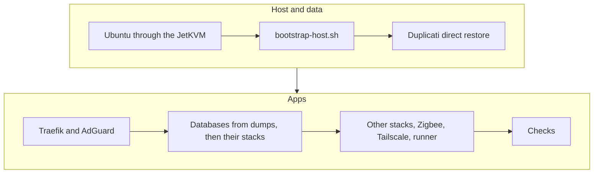

<!--
Recovery pack template (R23). scripts/make-dr-pdf.sh fills it in and renders the PDF:
{{dr.KEY}} comes from dr.env, {{<service>.KEY}} from services/<service>/.env, {{gen.DATE}},
{{gen.COMMIT}} and {{gen.DOMAIN}} from the script, and <domain> becomes the real domain.
Fenced divs: {include="docs/x.md"} inserts that file, .accounts and .secrets build tables,
.landscape prints its pages landscape.
This file is public: keys and placeholders only, never the facts themselves. Secrets are
printed in Appendix A only; the parts name the key to look up.
-->

# Start here

This pack is for {{dr.SUCCESSOR}}, and for a technical helper they hand it to. It explains how to keep the home server's services going, or wind them down, if {{dr.OWNER}} can't.

It was printed on {{gen.DATE}}. If that is more than six months ago some details may have changed: the newest copy wins.

**It holds the passwords to everything.** Keep it {{dr.PACK_COPIES}} and shred older copies.

| If you are | Read |
|---|---|
| {{dr.SUCCESSOR}}, or family taking over | Part 1, then Part 2. Neither needs technical skills. |
| A technical helper | Part 3, with the appendices |

## Contacts

| Who | Role | Contact |
|---|---|---|
| {{dr.SUCCESSOR}} | Takes over or winds down. Has Emergency Access to {{dr.OWNER}}'s passwords. | {{dr.SUCCESSOR_CONTACT}} |
| {{dr.HELPER}} | Technical helper | {{dr.HELPER_CONTACT}} |

If no helper is listed, anyone comfortable with Linux, Docker and git can follow Part 3.

## The equipment

- **The server** ({{dr.SERVER_HOSTNAME}}), {{dr.SERVER_LOCATION}}: runs every app.
- **The NAS** (a Synology storage box), {{dr.NAS_LOCATION}}: holds the photos, films, books and the backups. Don't unplug it or take its disks out.
- **The router** (UniFi), the switches and the **JetKVM** (a small box that lets a helper control the server remotely).

# Part 1: Take over or wind down

## The first weeks

Nothing has to happen straight away. The server, the NAS and the internet keep running on their own and install their own security updates. Leave them switched on.

What stops first if nothing is done:

- The domain name **{{gen.DOMAIN}}** renews on **{{dr.DOMAIN_RENEWS}}**. If it lapses, every address ending in {{gen.DOMAIN}} stops working, the photo and password apps included. The files on the NAS are not affected.
- Paid accounts (Part 2) keep charging until they are cancelled.
- If the server breaks, the apps stop. The photos, films and books are still on the NAS (see *Copy the data off*), and a helper can rebuild the server with Part 3.

## Passwords

{{dr.OWNER}}'s passwords are in Vaultwarden, a password manager that runs on the server (`https://warden.{{gen.DOMAIN}}`, or the Bitwarden app).

- **Emergency Access.** {{dr.SUCCESSOR}} has Emergency Access ({{dr.EA_TYPE}}). Log in to your own Vaultwarden account, open **Settings → Emergency access**, find {{dr.OWNER}} under *Designated as emergency contact*, and choose **Request access**. After {{dr.EA_WAIT_DAYS}} days you can open their vault.
- **This only works while the server runs.** If it doesn't, the logins in Appendix A are enough to copy the data off, read the email and cancel the accounts in Part 2. Once a helper has rebuilt the server, Emergency Access works again.
- **The main email** is {{dr.EMAIL_ACCOUNT}} (Appendix A: `EMAIL_PASSWORD`; second factor: {{dr.EMAIL_2FA}}). Password resets for almost every account go there, so keep it until last.

## Copy the data off

| What | Where | Readable without the server? |
|---|---|---|
| Photos and videos (Immich) | NAS, `photos` share, `library` folder (about 240 GB) | Yes, ordinary files |
| Films and TV (Plex) | NAS, `Video` share | Yes |
| Ebooks (Grimmory) | NAS, `Downloads` share, `Grimmory` folder | Yes |
| Passwords (Vaultwarden) | The server | No: Emergency Access, or each person exports their own |
| Wiki (BookStack), notes (Obsidian), Home Assistant | The server, with encrypted backups on the NAS | No: needs the server, or a helper restoring the backup |

To copy the photos:

1. Plug an external drive with at least 300 GB free into a computer at home.
2. Open the NAS. Windows: type `\\192.168.10.7\photos` in File Explorer's address bar. Mac: Finder → **Go → Connect to Server** → `smb://192.168.10.7/photos`.
3. Log in with the NAS login (Appendix A: `NAS_ADMIN_USER`, `NAS_ADMIN_PASSWORD`).
4. Copy the `library` folder to the drive. It takes hours. Check a few photos open from the drive afterwards.

Family can also save their own photos from the Immich app.

## Who uses what

Tell these people before anything is switched off, and give them a few weeks. The full list is Appendix C.

- **Vaultwarden (passwords):** family. Each person exports their own vault (**Tools → Export vault**) and imports it into another password manager; Bitwarden imports it as it is.
- **Immich (photos):** family. Each person downloads what they want, or takes a copy from the drive above.
- **Home Assistant (lights and switches at home):** {{dr.OWNER}} and partner. It stops when the server does; the switches still work by hand.
- **BookStack (wiki), Grimmory (ebooks), Seerr (film requests):** family and friends.
- **Plex (films and TV):** family. It runs on the NAS, so it keeps working while the NAS is on.

## Winding down, in order

1. Tell the people above and agree a date a few weeks away.
2. They export their passwords and photos.
3. Copy the data off (above) and check the copy on another computer.
4. Cancel the accounts in Part 2, in the order listed.
5. Switch the server off. The NAS can keep running for files and Plex, or go off once everything is copied.
6. Shred every copy of this pack.

# Part 2: Accounts to cancel or keep

In the order to cancel them: paid accounts that renew themselves first, the email last. Logins are in Vaultwarden; the registrar's and the email's are also in Appendix A.

::: accounts
:::

**The domain.** A `.au` domain can only be held by someone who meets auDA's eligibility rules, and it moves to a new holder only through the registrar's change-of-registrant process. If nobody needs the addresses, let it lapse after everything else is off.

# Part 3: Rebuild the server

For a helper comfortable with Linux, Docker and git. The repo's `services/*/README.md` files have the details behind each step. Logins are in Appendix A, IP addresses in Appendix B.



## What broke?

| Case | What survives | Start at |
|---|---|---|
| Server disk or Ubuntu | The NAS: backups, photos, media | 1. Install Ubuntu |
| The whole server (new hardware) | The same; move the Zigbee dongle across | 1. Install Ubuntu, then update the DHCP reservation |
| The NAS too | The offsite copy, if one exists: {{dr.OFFSITE_PROVIDER}} | Get the NAS disks recovered first: until an offsite copy exists, the photos are only there |

## You need

- The JetKVM at `https://192.168.10.101` (Appendix A: `JETKVM_PASSWORD`), cabled to the server's HDMI and USB. Or a screen and keyboard.
- An Ubuntu Server 26.04 LTS ISO. The JetKVM can mount it as virtual media.
- GitHub access as `{{dr.GITHUB_USER}}` (Appendix A; second factor: {{dr.GITHUB_2FA}}). The public copy, `homelab-public`, has the same scripts and docs.
- The Duplicati passphrase (Appendix A: `DUPLICATI_NAS_FULL_PASSPHRASE`). **Without it the backups can't be opened.**
- The Zigbee USB dongle from the old server.

## 1. Install Ubuntu

- Ubuntu Server 26.04 LTS with OpenSSH. Hostname `{{dr.SERVER_HOSTNAME}}`, user `{{dr.SERVER_USER}}`.
- The router gives the server `192.168.10.103` through a DHCP reservation for its network card. On new hardware, move the reservation to the new card in UniFi (Appendix A: `UNIFI_ADMIN_USER`). The port forward, DNS and the Tasmota devices all expect `.103`.
- While the server is down, use IP addresses: the NAS's AdGuard still answers, but it points every `*.{{gen.DOMAIN}}` name at the server.

## 2. Bootstrap

```bash
sudo apt-get install -y gh git
gh auth login
git clone https://github.com/{{dr.GITHUB_USER}}/homelab ~/homelab
nano ~/.smbcredentials   # username=<SMB_USER>, then password=<SMB_PASSWORD>
chmod 600 ~/.smbcredentials
sudo ~/homelab/scripts/bootstrap-host.sh
sudo systemctl restart docker
```

Log out and back in (Docker group), then check `ls /media/Backups/Duplicati` lists the backup folders.

## 3. Restore from Duplicati

Duplicati's own settings are not in the backup, so it starts empty and restores straight from the backup files.

1. `cd ~/homelab/services/duplicati && cp .env.sample .env`, then fill it in from Appendix A (`services/duplicati/.env`). New random values for the encryption key and UI password are fine.
2. `docker network create proxy && docker compose up -d`, then open `http://192.168.10.103:8200`.
3. **Restore → Direct restore from backup files**: local folder `/backups/nas-full`, passphrase `DUPLICATI_NAS_FULL_PASSPHRASE`. Pick the newest version, select everything, and restore to `/config/restore` with **Restore read/write permissions** ticked.
4. `docker compose down && docker network rm proxy`: Traefik creates that network itself.
5. The files are now under `/srv/appdata/duplicati/restore`. Move them into place with `sudo`:
    - the restored `appdata/*` → `/srv/appdata/` (keep the new `duplicati` folder)
    - `backups/db` → `/srv/backups/db`
    - each `services/<name>/.env` → `~/homelab/services/<name>/.env`, owned by `{{dr.SERVER_USER}}`
6. Check ownership against the service READMEs (Authentik's `data` must be uid 1000), then run `~/homelab/scripts/check-env.sh`: every line should say `OK`.

Live database files are not in the backup: each database comes back from its nightly dump in step 4.

## 4. Start the stacks

Start each with `docker compose up -d --wait` in `~/homelab/services/<name>`:

1. `traefik` first (it creates the `proxy` network), then `adguard`.
2. Each stack with a database: start only the database, load `/srv/backups/db/<container>/latest.sql.gz` as its README's *Restore* section says, then start the stack: `authentik`, `vaultwarden`, `immich`, `bookstack`, `grimmory`, `home` (Home Assistant's history).
3. The rest: `tailscale`, `tools`, `media`, `obsidian`, `portainer-agent`, `duplicati` (now with its restored `.env`).
4. Duplicati: recreate the `nas-full` job from `services/duplicati/README.md`, with the same passphrase and destination.

## 5. Zigbee, Tailscale and the runner

- **Zigbee:** plug the old dongle in. `ls /dev/serial/by-id/` must match `ZIGBEE_DONGLE` in `services/home/.env`. A new dongle of the same type: update `ZIGBEE_DONGLE`; Zigbee2MQTT restores the network from `coordinator_backup.json` on first start (check its log). Otherwise every device must be paired again.
- **Tailscale:** if the node doesn't come back logged in, make a new auth key as in `services/tailscale/README.md`.
- **Deploys:** register the GitHub runner again and set the deploy mark (`docs/operations.md`, *Runner setup*).

## 6. Checks

- `docker ps`: every container healthy (`adguardhome_sync` and `portainer_agent` have no healthcheck).
- From a phone on mobile data (Wi-Fi off): `https://warden.{{gen.DOMAIN}}` and `https://immich.{{gen.DOMAIN}}` load and log in.
- `sudo systemctl start homelab-backup-db` and check `/srv/backups/db` gets today's dumps.
- Run the `nas-full` job once by hand.

# Appendix A: Passwords and keys

Each table is one file. To rebuild a lost file, type every key and value exactly as printed, one `KEY=value` per line with no spaces around `=`. Long values are split across lines only to fit the page: type them as one line.

## Logins and facts (`dr.env`)

::: {.secrets source="dr"}
:::

::: {.secrets source="services"}
:::

# Appendix B: Network

::: {include="docs/network.md"}
:::

:::: landscape
# Appendix C: Who uses what

::: {include="docs/access.md"}
:::
::::
